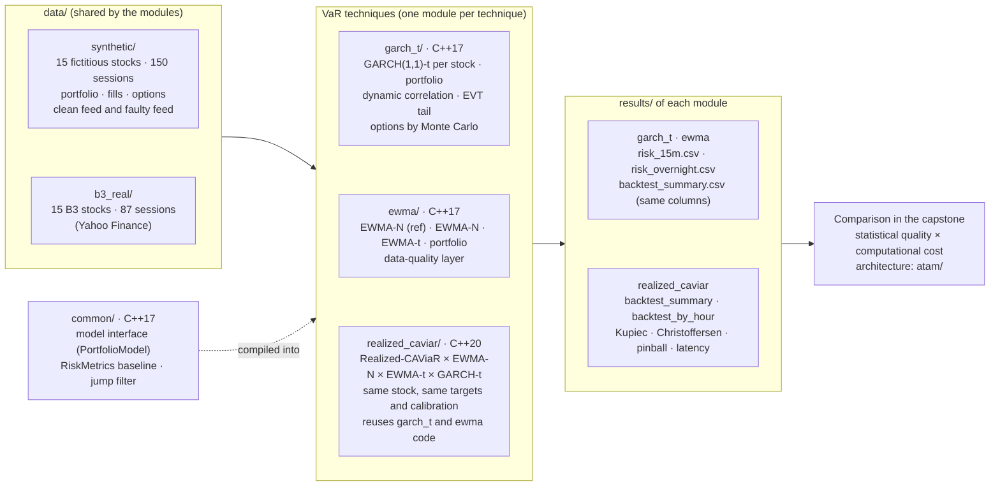
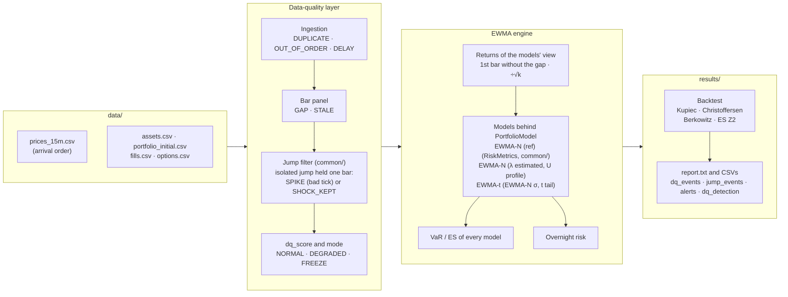
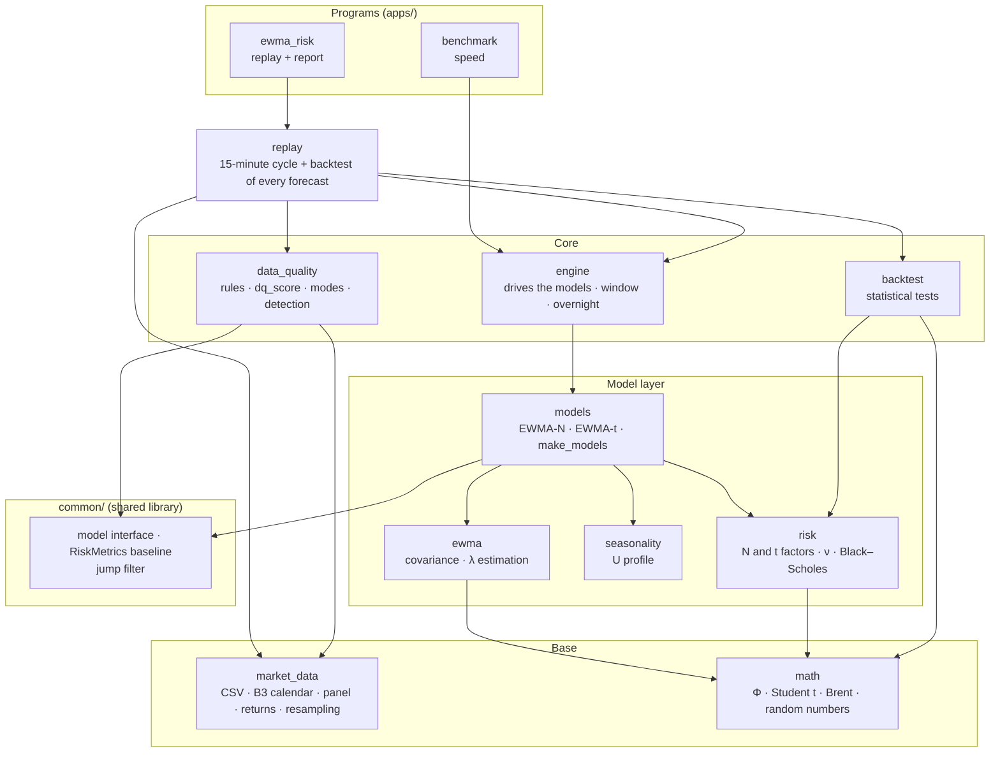
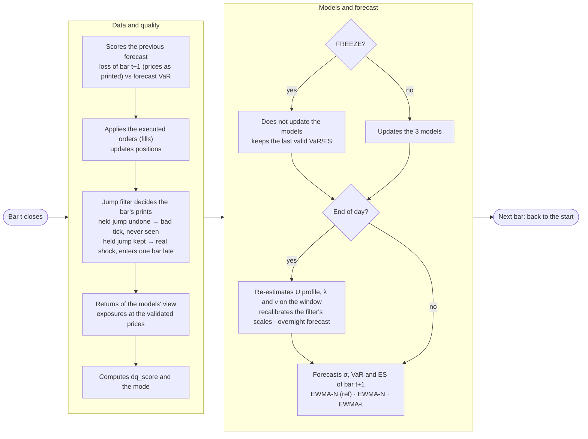
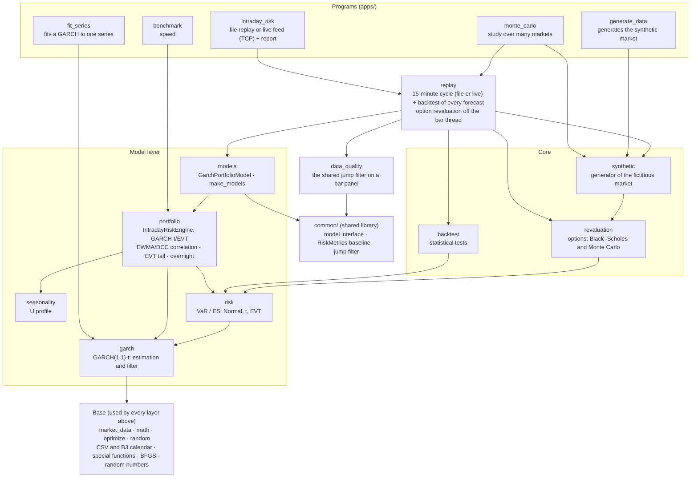
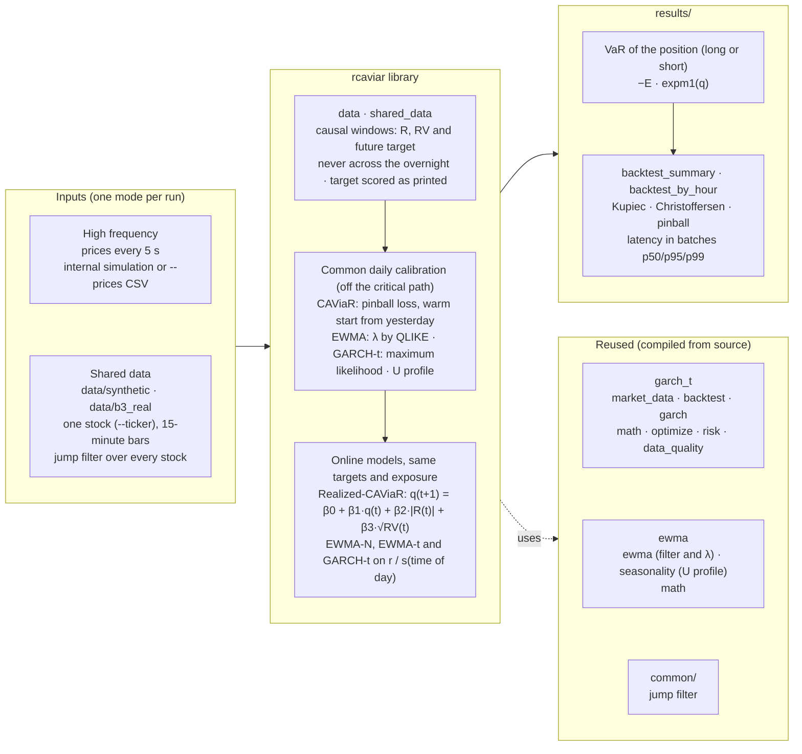

# Architecture of the intraday risk engine

Six views of the system: an overview with every module and the detail of each technique.

| View | Question | File |
|---|---|---|
| 0. Overview | what are the parts of the system and how do they connect? | [`00_overview.mmd`](00_overview.mmd) |
| 1. EWMA: data flow | what happens to a price from the file to the VaR? | [`01_ewma_data_flow.mmd`](01_ewma_data_flow.mmd) |
| 2. EWMA: modules | how is the code of `ewma` organized? | [`02_ewma_modules.mmd`](02_ewma_modules.mmd) |
| 3. EWMA: 15-minute cycle | what does the engine do at every bar? | [`03_ewma_15min_cycle.mmd`](03_ewma_15min_cycle.mmd) |
| 4. GARCH-t: modules | how is the code of `garch_t` organized? | [`04_garch_t_modules.mmd`](04_garch_t_modules.mmd) |
| 5. Realized-CAViaR | how does the comparison of the four models work and what does it reuse? | [`05_realized_caviar.mmd`](05_realized_caviar.mmd) |

The diagrams are in [Mermaid](https://mermaid.js.org): they are text, versioned in git, and render on GitHub
and in VS Code (extension *Markdown Preview Mermaid Support*).

`architecture.pdf` (for the shared drive) and the PNG/SVG files of this folder are generated by
`.\generate_pdf.ps1` from the `.mmd` files; run it again after editing a diagram.

---

## 0. Overview

Each technique is a module of its own that reads the same data in `data/`. `garch_t` and `ewma` work at portfolio level and write `backtest_summary.csv` with the same columns. `realized_caviar` runs the central comparison of the capstone: Realized-CAViaR, EWMA-N, EWMA-t and GARCH-t on the same stock, the same targets, the same exposure and the same calibration calendar, compiling parts of `garch_t` and `ewma`. The shared library `common/` is compiled into the three engines: the common model interface, the RiskMetrics baseline (EWMA-N (ref), one implementation) and the jump filter that protects every engine from bad ticks. The comparison is statistical quality versus computational cost; `atam/` evaluates the architecture.

## 1. EWMA: data flow

From the price file to the report. The prices go through the data-quality layer first: its arrival rules and the frozen-quote rule decide what the engine receives, and the shared jump filter decides the models' view of each bar. The engine runs its three models behind the common interface; the backtest compares the forecasts with what happened, on the prices as printed.

## 2. EWMA: modules

The code in layers: each module uses only those of the layers below it. Each box is a pair `include/ewmar/<name>.hpp` + `src/<name>.cpp` in `ewma/source/`; `models` registers the models (`make_models`), and adding one is a class there.

## 3. EWMA: 15-minute cycle

What happens at each closed bar. The update takes a few microseconds; the end-of-day re-estimation a few milliseconds (15 stocks).

## 4. GARCH-t: modules

The code of `garch_t`, from the `#include`s of `garch_t/source/`. Each box is a pair `include/garcht/<name>.hpp` + `src/<name>.cpp`. The model layer is `portfolio` (`IntradayRiskEngine`, the GARCH-t/EVT model) with `models`, which puts it and the shared baseline behind the common interface; `synthetic` generates the fictitious market used by every module; `revaluation` revalues the options by Monte Carlo, off the bar thread; `data_quality` applies the shared jump filter to a bar panel.

## 5. Realized-CAViaR

Third technique and central comparison (C++20). Realized-CAViaR estimates the 1% return quantile (VaR 99%) directly, by a recursion on the aggregate return R and the realized variance RV of the previous window. In the same run an EWMA-N, an EWMA-t and a GARCH-t of one stock are calibrated on the same calendar (daily re-estimation; CAViaR starts from yesterday's parameters) and scored on the same targets, on returns divided by the intraday profile. In shared-data mode the jump filter runs over every stock first; the models see the filtered prices, the forecasts are scored on the printed ones. Calibration is off the critical path; latency is measured in batches. Two input modes: prices every 5 s, or one stock of `data/` in 15-minute bars.

---

Details of each component (formulas, rules and parameters) are in
[`common/README.md`](../common/README.md), [`ewma/README.md`](../ewma/README.md),
[`garch_t/README.md`](../garch_t/README.md) and [`realized_caviar/README.md`](../realized_caviar/README.md).
