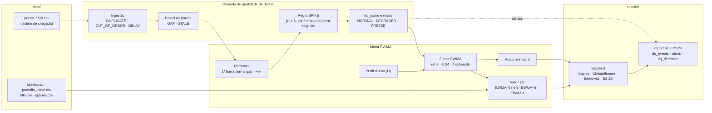
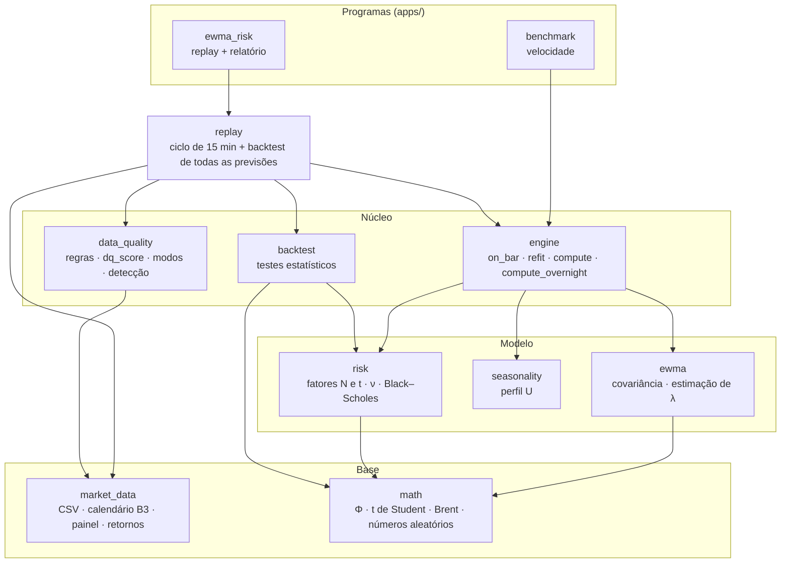
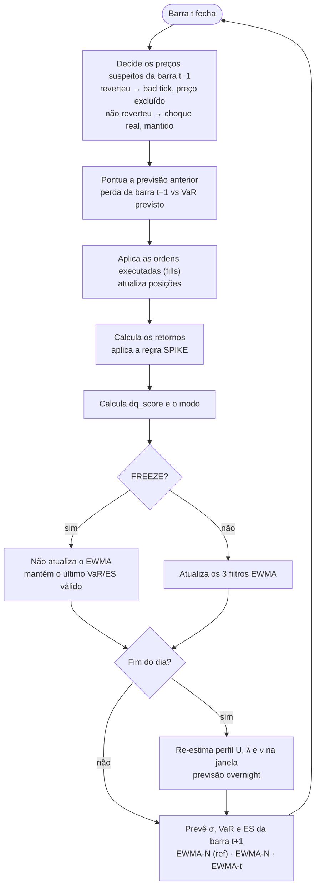

# Arquitetura do motor de risco intraday (módulo EWMA)

Três vistas complementares do sistema, cada uma respondendo a uma pergunta:

| Vista | Pergunta | Arquivo |
|---|---|---|
| 1. Fluxo de dados | o que acontece com um preço desde o arquivo até o VaR? | [`01_fluxo_de_dados.mmd`](01_fluxo_de_dados.mmd) |
| 2. Módulos | como o código está organizado? | [`02_modulos.mmd`](02_modulos.mmd) |
| 3. Ciclo de 15 minutos | o que o motor faz a cada barra? | [`03_ciclo_15min.mmd`](03_ciclo_15min.mmd) |

Os diagramas estão em [Mermaid](https://mermaid.js.org): são texto, ficam versionados no git e
aparecem desenhados no GitHub e no VS Code (extensão *Markdown Preview Mermaid Support*). Para
colocar no texto do TCC, cole o conteúdo de um `.mmd` em [mermaid.live](https://mermaid.live) e
exporte em PNG ou SVG.

---

## 1. Fluxo de dados

Do arquivo de preços até o relatório. Os preços passam primeiro pela camada de qualidade de dados,
que decide o que o motor pode usar; o motor produz as previsões dos três modelos; o backtest as
compara com o que aconteceu.

## 2. Módulos

Organização do código em camadas: cada módulo usa apenas os das camadas abaixo dele. Cada caixa é
um par `include/ewmar/<nome>.hpp` + `src/<nome>.cpp` em `ewma/source/`.

## 3. Ciclo de 15 minutos

O que acontece a cada barra fechada. A atualização leva cerca de 1 µs; a re-estimação do fim do
dia, cerca de 4 ms (15 ações).

---

Detalhes de cada componente (fórmulas, regras e parâmetros) estão em
[`ewma/README.md`](../ewma/README.md).
