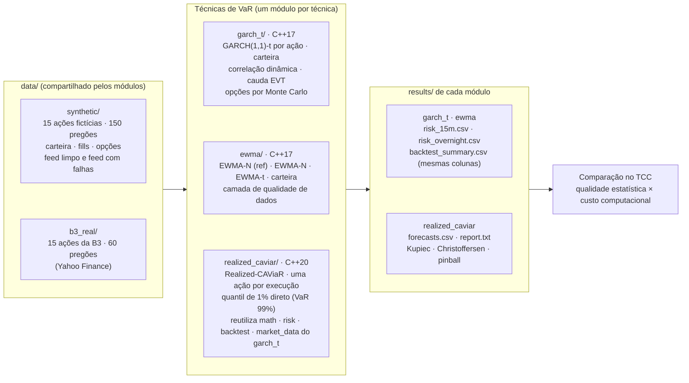
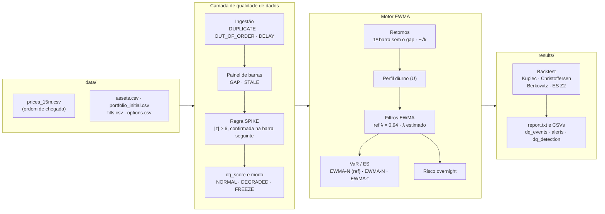
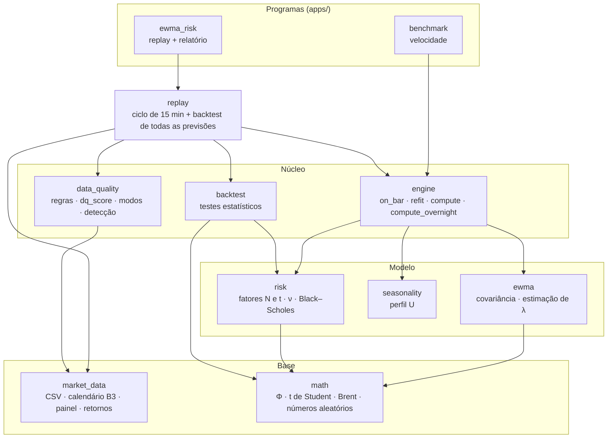
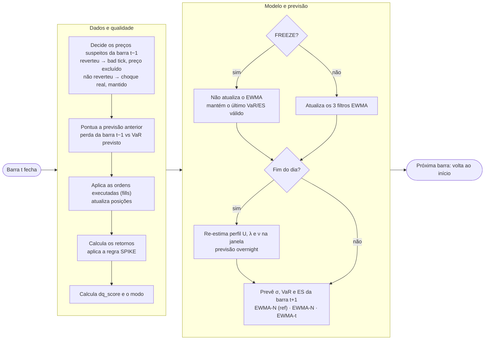
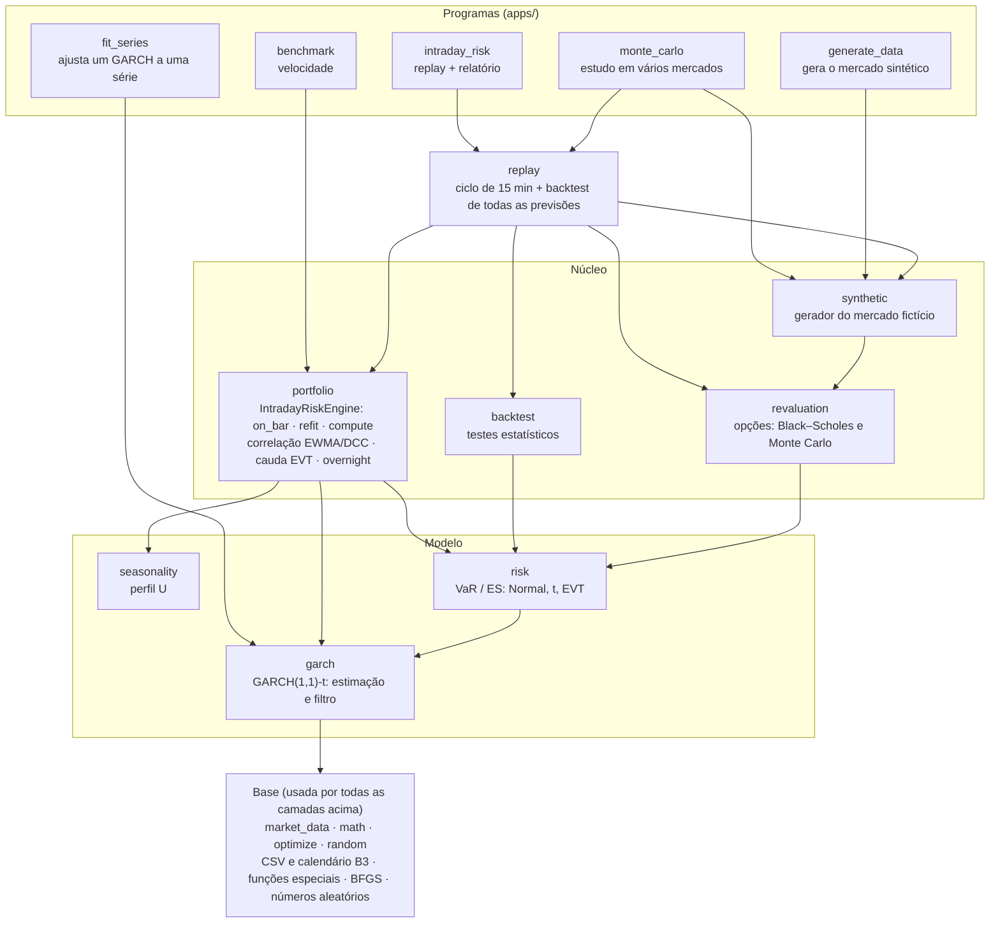
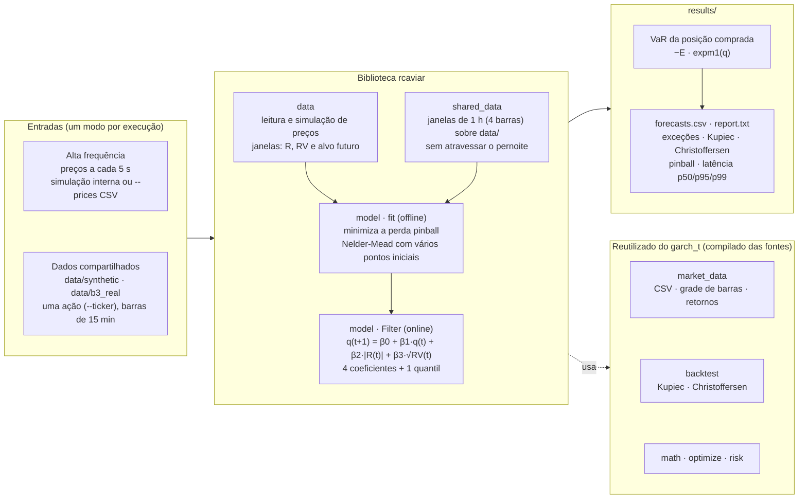

# Arquitetura do motor de risco intraday

Seis vistas do sistema: uma visão geral com todos os módulos e o detalhe de cada técnica.

| Vista | Pergunta | Arquivo |
|---|---|---|
| 0. Visão geral | quais são as partes do sistema e como se ligam? | [`00_visao_geral.mmd`](00_visao_geral.mmd) |
| 1. EWMA: fluxo de dados | o que acontece com um preço desde o arquivo até o VaR? | [`01_fluxo_de_dados.mmd`](01_fluxo_de_dados.mmd) |
| 2. EWMA: módulos | como o código do `ewma` está organizado? | [`02_modulos.mmd`](02_modulos.mmd) |
| 3. EWMA: ciclo de 15 minutos | o que o motor faz a cada barra? | [`03_ciclo_15min.mmd`](03_ciclo_15min.mmd) |
| 4. GARCH-t: módulos | como o código do `garch_t` está organizado? | [`04_modulos_garch_t.mmd`](04_modulos_garch_t.mmd) |
| 5. Realized-CAViaR | como o `realized_caviar` funciona e o que reutiliza? | [`05_realized_caviar.mmd`](05_realized_caviar.mmd) |

Os diagramas estão em [Mermaid](https://mermaid.js.org): são texto, ficam versionados no git e
aparecem desenhados no GitHub e no VS Code (extensão *Markdown Preview Mermaid Support*).

O PDF `arquitetura.pdf` (para o drive compartilhado) e os PNG/SVG desta pasta são gerados por
`.\gerar_pdf.ps1` a partir dos `.mmd`; rode-o de novo depois de editar um diagrama.

---

## 0. Visão geral

Cada técnica é um módulo próprio que lê os mesmos dados de `data/`. O `garch_t` e o `ewma` são
independentes entre si e gravam o `backtest_summary.csv` com as mesmas colunas. O `realized_caviar`
reutiliza parte do código do `garch_t` (compila `math`, `optimize`, `risk`, `backtest` e
`market_data` a partir das fontes dele), trabalha com uma ação por execução e grava os próprios
arquivos (`forecasts.csv`, `report.txt`). A comparação do TCC é qualidade estatística versus custo
computacional.

## 1. EWMA: fluxo de dados

Do arquivo de preços até o relatório. Os preços passam primeiro pela camada de qualidade de dados,
que decide o que o motor pode usar; o motor produz as previsões dos três modelos; o backtest as
compara com o que aconteceu.

## 2. EWMA: módulos

Organização do código em camadas: cada módulo usa apenas os das camadas abaixo dele. Cada caixa é
um par `include/ewmar/<nome>.hpp` + `src/<nome>.cpp` em `ewma/source/`.

## 3. EWMA: ciclo de 15 minutos

O que acontece a cada barra fechada. A atualização leva cerca de 1 µs; a re-estimação do fim do
dia, cerca de 4 ms (15 ações).

## 4. GARCH-t: módulos

Organização do código do `garch_t` (módulo do colega), levantada a partir dos `#include` de
`garch_t/source/`. Cada caixa é um par `include/garcht/<nome>.hpp` + `src/<nome>.cpp`. O
núcleo é o `portfolio` (`IntradayRiskEngine`); `synthetic` gera o mercado fictício usado por
todos os módulos, e `revaluation` reavalia as opções por Monte Carlo.

## 5. Realized-CAViaR

Terceira técnica (C++20). Em vez de estimar a volatilidade e supor uma distribuição, estima
diretamente o quantil de 1% do retorno (VaR 99%) por uma recursão que usa o retorno agregado R e a
variância realizada RV da janela anterior. Os coeficientes são estimados uma vez, fora do caminho
crítico, minimizando a perda pinball; a atualização online só aplica a recursão. Há dois modos de
entrada: preços a cada 5 s (simulação própria ou CSV) ou uma ação dos dados compartilhados de
`data/`, em barras de 15 min. A caixa da direita mostra o código que vem do `garch_t`.

---

Detalhes de cada componente (fórmulas, regras e parâmetros) estão em
[`ewma/README.md`](../ewma/README.md), [`garch_t/README.md`](../garch_t/README.md) e
[`realized_caviar/README.md`](../realized_caviar/README.md).